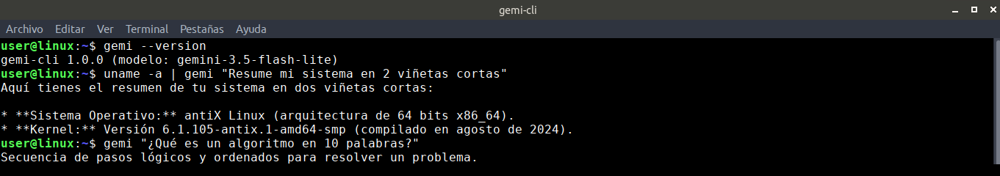
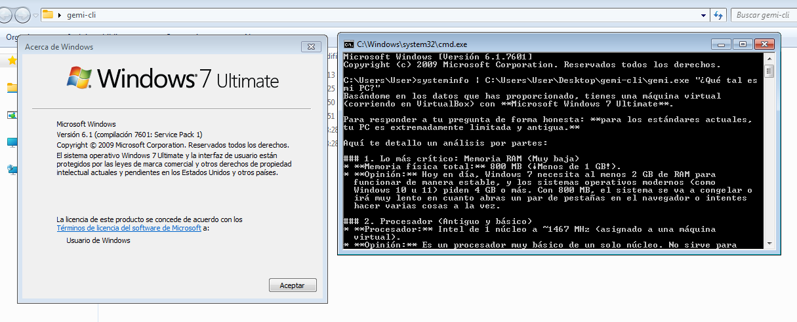

# Gemi-CLI

<p align="center">
  <b><a href="README.md">English Version</a></b> • <b>Español</b>
</p>

> **Cliente de Terminal Ultraligero para la API de Gemini (Linux y Windows)**  
> Compilado de forma nativa en Nim sin dependencias externas de paquetes. Pensado para equipos de bajos recursos (Intel Celeron, Atom, laptops antiguas y PCs con 2 GB de RAM).
> *Disponible para Linux y Windows (7 SP1, 8.1, 10 LTSB/LTSC y 11).*

[](LICENSE)
[](#requisitos)
[](#compilacion-desde-el-codigo-fuente)

<p align="center">
  
</p>
<p align="center">
  
</p>

---

## El Problema que Resuelve

Abrir la interfaz web de Gemini en un navegador moderno consume entre **600 MB y 900 MB de RAM** en una sola pestaña, y el cliente oficial `@google/gemini-cli` requiere **Node.js 20+**, dejando fuera sistemas antiguos y penalizando el arranque en discos duros mecánicos (HDD).

**Gemi-CLI (`gemi`)** es un único ejecutable compilado a código máquina nativo:
- **Peso del binario:** ~245 KB en Linux.
- **Consumo real de RAM:** ~10.1 MB en consultas de texto (~25.7 MB adjuntando una imagen PNG de 7 MB).
- **Arranque instantáneo:** sin máquinas virtuales, sin Node.js y sin Python.
- **Tuberías UNIX y soporte multimodal:** recibe texto por argumentos, `stdin` (`cat`, `git diff`, logs) y adjuntos con `-f` (código fuente, texto, `PNG`, `JPG`, `WEBP` y `PDF`).

| Métrica (medida en Intel Celeron N2805, 2 GB DDR3, antiX Linux) | Gemini en Navegador Web | `gemini-cli` (Node.js) | **Gemi-CLI (`gemi`)** |
| :--- | :--- | :--- | :--- |
| **Tamaño en disco** | > 300 MB (Navegador) | > 120 MB (Runtime Node + deps) | **~245 KB** |
| **Consumo de RAM (consulta de texto)** | 600 MB - 900 MB | 80 MB - 160 MB | **~10.1 MB** |
| **Dependencias de runtime** | Navegador moderno | Node.js 20+ | **Ninguna (solo libc + OpenSSL)** |
| **Privacidad** | Cookies y telemetría web | Telemetría configurable | **Cero telemetría (API REST directa)** |

---

## Características Principales

- **Configuración segura en el primer uso (*First-run setup*):** si aún no tienes configurada tu clave de [Google AI Studio](https://aistudio.google.com/apikey), `gemi` te la solicita con entrada oculta en consola (sin dejar rastro en el historial) y la guarda en `~/.config/gemi-cli/config` con permisos `0600` en Linux, o cifrada con **Windows DPAPI** (`CryptProtectData`) en `%APPDATA%\gemi-cli\config` en Windows.
- **Soporte nativo en Windows 7+:** entrada/salida de consola en UTF-16 (`WriteConsoleW` / `ReadConsoleW`), detección automática del idioma del sistema, `cacert.pem` + OpenSSL 1.1.1k incluidos y prompt interactivo al abrir con doble clic desde el Explorador.
- **Adjuntos multimodales verificados (`-f`):** adjunta uno o varios archivos de código, texto plano (máx. 1 MB), imágenes (`PNG`, `JPG`, `WEBP`) o documentos `PDF` (máx. 8 MB por archivo, validando la cabecera binaria real y no solo la extensión).
- **Formato limpio en terminal:** ajusta automáticamente el texto al ancho de tu ventana sin cortar palabras por la mitad, alinea listas y respeta intactos los bloques de código y las redirecciones a archivos (`>`).
- **Búsqueda web en tiempo real opcional (`-w` / `--web`):** conecta la consulta a Google Search Grounding cuando necesitas datos actuales e imprime las fuentes/URLs al final (o avisa si respondió sin búsqueda), manteniéndolo apagado por defecto para cuidar tu velocidad y tu cuota diaria.
- **Interfaz bilingüe automática:** detecta `LC_ALL` / `LC_MESSAGES` / `LANG` para mostrar ayuda, avisos y errores en español o en inglés por defecto.
- **Tolerancia a fallos de red:** reintentos automáticos ante saturación temporal del servidor (`HTTP 429`, `500`, `503`) y corte limpio a los 60 segundos si un modelo no responde.
- **Seguridad defensiva:** autenticación exclusiva por cabecera HTTP (`x-goog-api-key`), redirecciones desactivadas (`maxRedirects = 0`), validación estricta de certificados TLS y filtrado de secuencias de escape ANSI.

---

## Instalación en Linux

No modifica `.bashrc`, `/etc` ni configuraciones previas del sistema; únicamente instala el ejecutable en `~/.local/bin/gemi`.

### Requisitos
- `openssl` (`libssl.so.3` o `libssl.so.1.1`, preinstalado en casi cualquier distribución Linux).
- Compilador **Nim 2.x** y `gcc` (solo si compilas desde el código fuente).

```bash
git clone https://github.com/KennyWaddell/gemi-cli.git
cd gemi-cli
chmod +x build.sh install.sh uninstall.sh
./install.sh
```

Para desinstalar:
```bash
./uninstall.sh
```

---

## Instalación en Windows (Portable)

Probado de forma nativa en **Windows 7 SP1** (sin capas de compatibilidad) y compatible con **Windows 8.1, 10 (LTSB/LTSC) y 11**.

1. Descarga `gemi-cli-v1.0.0-win64.zip` desde [GitHub Releases](https://github.com/KennyWaddell/gemi-cli/releases) y verifica su suma con `SHA256.txt`.
2. Descomprime la carpeta `Gemi-CLI Windows` (mantén juntos `gemi.exe`, `cacert.pem`, `libcrypto-1_1-x64.dll` y `libssl-1_1-x64.dll`).
3. **Haz doble clic en `gemi.exe`** para preguntar directamente (acepta `--help`, `--set-key`, `--set-model` y `exit`/`salir` para cerrar), **o** abre `cmd.exe` / PowerShell:
   ```cmd
   systeminfo | gemi "Analiza este hardware y dime qué tal es mi PC"
   ```
   *(Opcional: ejecuta `install.bat` para añadir la carpeta al `PATH` de tu usuario sin permisos de administrador y poder usar `gemi` desde cualquier terminal.)*

---

## Uso Rápido

```bash
# Consulta directa (en la primera ejecucion te pedira pegar tu API key de forma oculta)
gemi "Explica en dos lineas que es una llamada al sistema (syscall)"

# Analizar salida de comandos por tuberia (pipe)
uname -a | gemi "¿Que arquitectura y kernel tengo?"
git diff | gemi "Revisa si hay algun bug en estos cambios"

# Adjuntar codigo, imagenes o PDFs (puedes repetir -f varias veces)
gemi -f main.c "¿Hay alguna fuga de memoria en este archivo?"
gemi -f captura_error.png "¿Que significa este error y como lo corrijo?"
gemi -f manual.pdf "Resume los puntos clave en 5 viñetas"

# Consulta con acceso a Internet en tiempo real (Google Search)
gemi -w "¿Cual es la ultima version estable del kernel Linux publicada hoy?"

# Elegir otro modelo de Gemini
gemi -m gemini-2.5-flash "Hola"

# Preguntas que empiezan con guion (usar --)
gemi -- "-O2 vs -O3 en gcc"

# Cambiar o actualizar tu API key guardada
gemi --set-key
```

Para fijar un modelo distinto de forma permanente sin escribir `-m` cada vez, ejecuta `gemi --set-model nombre_del_modelo`. Puedes verificar qué modelo está activo en cualquier momento con `gemi -v`.

---

## Opciones de Línea de Comandos

| Opción | Descripción |
| :--- | :--- |
| `-w`, `--web` | Activa búsqueda en vivo con Google Search Grounding para datos actuales. |
| `-m`, `--model <id>` | Usa un modelo específico en esa consulta (ej. `gemini-3.8-flash`). Por defecto usa `gemini-3.5-flash-lite` por ofrecer la menor latencia y la cuota gratuita diaria más alta en AI Studio. |
| `-f`, `--file <ruta>` | Adjunta un archivo de texto/código (máx. 1 MB) o binario (`PNG`, `JPG`, `WEBP`, `PDF`, máx. 8 MB). Se puede repetir varias veces (tope total: 16 MB). |
| `--set-key` | Solicita y guarda tu `GEMINI_API_KEY` con entrada oculta (`0600` en Linux, DPAPI en Windows). |
| `--set-model <id>` | Cambia y guarda de forma permanente tu modelo por defecto en `config`. |
| `-v`, `--version` | Muestra la versión instalada y el modelo activo actual. |
| `-c`, `--credits` | Muestra los créditos de autoría, licencia y URL del repositorio. |
| `-h`, `--help` | Muestra la ayuda rápida y el orden de prioridad de configuración. |
| `--` | Trata todo lo que sigue como texto literal (útil si tu pregunta empieza con `-`). |

---

## Alcance y Limitaciones Conocidas

Para mantener el ejecutable en ~245 KB, sin dependencias externas y apto para PCs con 2 GB de RAM, Gemi-CLI aplica decisiones de diseño deliberadas:

- **Modelo BYOK (*Bring Your Own Key*):** no incluye claves preconfiguradas. Requiere tu propia clave gratuita o de pago de [Google AI Studio](https://aistudio.google.com/apikey) y está sujeto a los límites de peticiones (RPM/RPD) de tu proyecto en Google Cloud.
- **Consultas independientes (*stateless*):** cada ejecución es independiente y no guarda historial de conversaciones en disco, priorizando privacidad y bajo uso de memoria.
- **Respuesta completa (sin *streaming* token a token):** utiliza el cliente HTTPS estándar de Nim (`std/httpclient`), por lo que imprime la respuesta formateada una vez recibida completa.
- **Límites estrictos de tamaño:** hasta `1 MB` para texto/tuberías (`stdin`) y `8 MB` por imagen o PDF (`16 MB` combinados) para evitar desbordamientos de RAM o *swapping* en discos mecánicos. No procesa archivos de audio ni vídeo pesado.

---

## Compilación desde el Código Fuente

```bash
./build.sh          # Compila el binario de Linux (./gemi)
./build.sh test     # Ejecuta la suite de pruebas unitarias
./build.sh win      # Compilacion cruzada a Windows x86_64 (windows/gemi.exe, requiere mingw-w64)
```

---

## Créditos

Hecho por **Kenny Waddell**.

## Licencia

Distribuido bajo la licencia **GNU GPLv3**. Consulta el archivo [LICENSE](LICENSE) para más detalles.
