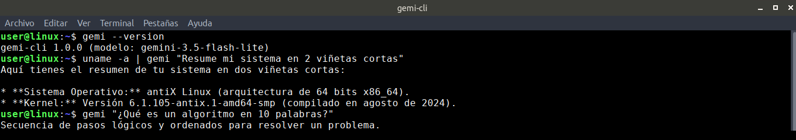
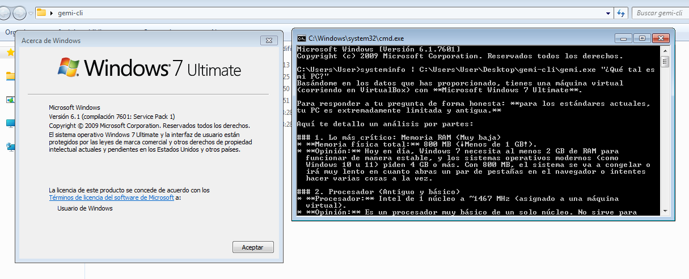

# Gemi-CLI

<p align="center">
  <b>English</b> • <b><a href="README.es.md">Leer en Español</a></b>
</p>

> **Ultralight Native Terminal Client for the Gemini API (Linux & Windows)**  
> Compiled to native machine code in Nim with zero external package dependencies. Built specifically for low-spec hardware (Intel Celeron, Atom, vintage laptops, and 2 GB RAM PCs).
> *Available for Linux and Windows (7 SP1, 8.1, 10 LTSB/LTSC, and 11).*

[](LICENSE)
[](#installation-on-linux)
[](#building-from-source)

<p align="center">
  
</p>
<p align="center">
  
</p>

---

## The Problem It Solves

Opening the Gemini web app in a modern browser consumes **600 MB to 900 MB of RAM** in a single tab, while the official `@google/gemini-cli` requires **Node.js 20+**, dropping support for legacy operating systems and adding cold-start overhead on mechanical hard drives (HDD).

**Gemi-CLI (`gemi`)** is a tiny standalone native binary:
- **Binary size:** ~245 KB on Linux.
- **Measured RAM usage:** ~10.1 MB for text queries (~25.7 MB when encoding and sending a 7 MB PNG image).
- **Instant startup:** no browser, no Node.js, no Python runtime.
- **UNIX pipes & multimodal attachments:** accepts arguments, `stdin` pipes (`cat`, `git diff`, logs), and `-f` file attachments (source code, plain text, `PNG`, `JPG`, `WEBP`, and `PDF`).

| Metric (measured on Intel Celeron N2805, 2 GB DDR3, antiX Linux) | Gemini in Web Browser | `gemini-cli` (Node.js) | **Gemi-CLI (`gemi`)** |
| :--- | :--- | :--- | :--- |
| **Disk footprint** | > 300 MB (Browser) | > 120 MB (Node runtime + deps) | **~245 KB** |
| **RAM usage (text query)** | 600 MB - 900 MB | 80 MB - 160 MB | **~10.1 MB** |
| **Runtime dependencies** | Modern browser | Node.js 20+ | **None (libc + OpenSSL only)** |
| **Privacy** | Web cookies & telemetry | Configurable telemetry | **Zero telemetry (direct REST API)** |

---

## Key Features

- **Secure first-run setup:** if no [Google AI Studio](https://aistudio.google.com/apikey) key is found, `gemi` prompts for it with hidden terminal input (keeping it out of shell history) and saves it to `~/.config/gemi-cli/config` with `0600` permissions on Linux, or encrypted with **Windows DPAPI** (`CryptProtectData`) in `%APPDATA%\gemi-cli\config` on Windows.
- **Native Windows 7+ support:** UTF-16 console I/O (`WriteConsoleW` / `ReadConsoleW`), automatic OS language detection, bundled `cacert.pem` + OpenSSL 1.1.1k, and a friendly interactive prompt when double-clicked from Explorer.
- **Optional multi-turn chat (`-i`) & system rules (`-s`):** run `gemi -i` for an in-memory multi-turn conversation (nothing saved to disk) and `-s "..."` to set a persistent `systemInstruction`.
- **Verified multimodal attachments & File API (`-f`):** attach text/code (up to 1 MB) or `PNG`, `JPG`, `WEBP`, `PDF` (up to 8 MB inline), or seamlessly upload heavy PDFs (`> 8 MB` up to `100 MB`) and audio/video (`MP3`, `WAV`, `OGG`, `M4A`, `FLAC`, `MP4`, `WEBM`) in 1 MB chunks via the Gemini File API (automatically deleted remotely after the query).
- **Model selector & 503/429 fallback:** run `gemi --models` (or `-m` / `--set-model` without a name) to pick from 5 recommended lightweight models (`gemini-3.5-flash-lite`, `gemini-3.1-flash-lite`, `gemini-3.8-flash`, `gemma-4-31b-it`, `gemma-4-26b-a4b-it`); on interactive `HTTP 503`/`429` overload, `gemi` offers switching to another model right away.
- **Image generation (`--img`):** optional `--img out.png "prompt"` using `gemini-3.1-flash-image` (requires an AI Studio project with `*-image` quota/billing enabled).
- **Smart terminal word-wrapping:** wraps paragraphs to your terminal width without splitting words mid-line, aligns bullet lists, and preserves code blocks (` ``` `) and file redirections (`>`) untouched.
- **Optional real-time web search (`-w` / `--web`):** enables Google Search Grounding on demand for up-to-date answers and prints source URLs at the end (or notifies if no search was triggered), keeping it off by default to preserve low latency and daily quota.
- **Automatic bilingual CLI:** detects `LC_ALL` / `LC_MESSAGES` / `LANG` to display help, prompts, and errors in Spanish or English by default.
- **Network resilience:** automatic retries on transient server load (`HTTP 429`, `500`, `503`) and clean 60-second timeout handling.
- **Defensive security:** header-only API key transmission (`x-goog-api-key`), HTTP redirects disabled (`maxRedirects = 0`), strict TLS certificate validation, and ANSI control-sequence stripping.

---

## Installation on Linux

Does not modify `.bashrc`, `/etc`, or existing system configurations; only copies the binary to `~/.local/bin/gemi`.

### Requirements
- `openssl` (`libssl.so.3` or `libssl.so.1.1`, pre-installed on virtually all Linux distros).
- **Nim 2.x** and `gcc` (only required when compiling from source).

```bash
git clone https://github.com/KennyWaddell/gemi-cli.git
cd gemi-cli
chmod +x build.sh install.sh uninstall.sh
./install.sh
```

To uninstall:
```bash
./uninstall.sh
```

---

## Installation on Windows (Portable)

Tested natively on **Windows 7 SP1** (without compatibility wrappers) and compatible with **Windows 8.1, 10 (LTSB/LTSC), and 11**.

1. Download `gemi-cli-v1.1.1-win64.zip` from [GitHub Releases](https://github.com/KennyWaddell/gemi-cli/releases) and verify its checksum against `SHA256.txt`.
2. Extract the `Gemi-CLI Windows` folder (keep `gemi.exe`, `cacert.pem`, `libcrypto-1_1-x64.dll`, and `libssl-1_1-x64.dll` together).
3. **Double-click `gemi.exe`** to ask questions directly (supports `--help`, `--set-key`, `--set-model`, and `exit`/`quit` to close), **or** open `cmd.exe` / PowerShell:
   ```cmd
   systeminfo | gemi "Analyze this hardware and rate my PC"
   ```
   *(Optional: run `install.bat` to add the folder to your User `PATH` without admin privileges so `gemi` works from any terminal.)*

---

## Quick Usage

```bash
# Direct prompt (first run securely prompts for your API key)
gemi "Explain in two lines what a Linux syscall is"

# Pipe command output via stdin
uname -a | gemi "What architecture and kernel am I running?"
git diff | gemi "Check these changes for potential bugs"

# Attach source code, images, or PDFs (-f can be repeated)
gemi -f main.c "Are there any memory leaks in this file?"
gemi -f error_screenshot.png "What caused this error and how do I fix it?"
gemi -f report.pdf "Summarize the key points in 5 bullets"

# Query with live Google Search grounding enabled
gemi -w "What is the latest stable Linux kernel version released today?"

# Use a specific Gemini model
gemi -m gemini-2.5-flash "Hello"

# Prompts starting with a dash (use --)
gemi -- "-O2 vs -O3 in gcc"

# Update or replace your stored API key
gemi --set-key
```

To set a custom default model permanently, run `gemi --set-model model_name`. You can check which model is currently active at any time by running `gemi -v`.

---

## Command-Line Options

| Option | Description |
| :--- | :--- |
| `-i`, `--interactive` | Starts an in-memory multi-turn chat session (zero disk history). |
| `-s`, `--system <rule>` | Sets a fixed system instruction (`systemInstruction`) for the model. |
| `-w`, `--web` | Enables live Google Search Grounding for up-to-date web information. |
| `-m`, `--model <id>` | Overrides the model for that query (omit `<id>` in interactive mode to pick from 5 recommended models). |
| `--models` | Lists the 5 recommended lightweight models and highlights the active one. |
| `-f`, `--file <path>` | Attaches text (`<=1 MB`), `PNG`/`JPG`/`WEBP`/`PDF` (`<=8 MB` inline), or heavy PDFs (`<=100 MB`) and audio/video (`MP3`, `WAV`, `OGG`, `M4A`, `FLAC`, `MP4`, `WEBM`) via chunked File API upload. |
| `-o`, `--out <path>` | Saves the response (or `-i` chat) to `.md` or Windows-friendly `.txt` (CRLF) in the current folder or given path. |
| `--img <path>` | Generates an image (`PNG`/`JPG`/`WEBP`) via `gemini-3.1-flash-image` (requires `*-image` quota). |
| `--set-key` | Prompts for and stores your `GEMINI_API_KEY` with hidden input (`0600` on Linux, DPAPI on Windows). |
| `--set-model <id>` | Permanently updates your default model inside `config`. |
| `-v`, `--version` | Prints the installed version along with the currently active model. |
| `-c`, `--credits` | Displays author credits, license, and repository URL. |
| `-h`, `--help` | Displays usage summary and configuration lookup priority. |
| `--` | Treats all subsequent arguments as literal prompt text (for prompts starting with `-`). |

---

## Scope & Known Limitations

To keep the binary around ~245 KB with zero external package dependencies on 2 GB RAM machines, Gemi-CLI makes intentional trade-offs:

- **BYOK (*Bring Your Own Key*):** no API keys are bundled. You provide your own free or paid key from [Google AI Studio](https://aistudio.google.com/apikey), subject to your Google Cloud project's RPM/RPD rate limits.
- **Stateless by default (optional in-memory `-i`):** normal commands run independently; `-i` keeps conversation turns in RAM only for the current session and never writes chat history to disk.
- **Full-response rendering (no token streaming):** relies exclusively on Nim's standard `std/httpclient`, formatting and printing the response once the HTTPS request completes.
- **Strict memory caps:** `1 MB` max for plain text/`stdin` pipes, `8 MB` per inline image/PDF (`16 MB` combined), and up to `100 MB` for heavy PDFs or audio/video streamed in `1 MB` chunks via the File API to avoid out-of-memory spikes on 2 GB RAM hardware.
- **Image generation (`--img`):** Google AI Studio's Free Tier currently assigns `0` quota to `*-image` models, so `--img` requires a billing-enabled API key and is included ready in case free quota becomes available in the future.

---

## Building from Source

```bash
./build.sh          # Build native Linux binary (./gemi)
./build.sh test     # Run unit and pipe test suite
./build.sh win      # Cross-compile Windows x86_64 binary (windows/gemi.exe, requires mingw-w64)
```

---

## Credits

Created by **Kenny Waddell**.

## License

Distributed under the **GNU GPLv3** license. See [LICENSE](LICENSE) for details.
